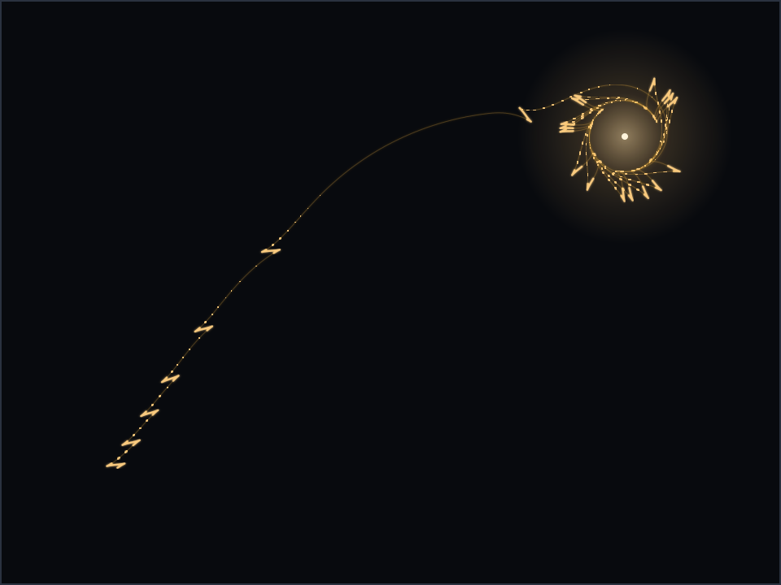

# Machina speculatrix

A working replica of W. Grey Walter's cybernetic tortoise (1948–49): light-seeking, obstacle-shy, and able to find its own way home to recharge, using reflexes alone.



*The path of one tortoise crossing a room toward a lamp. Bright bursts are the pilot lamp flaring on during each scan, faint curve is the dark run between. Walter made the same picture by bolting a light to the shell and leaving the camera shutter open.*

**[▶ Live simulation](https://bamicallef35-netizen.github.io/grey-walter-tortoise/)** · the browser model runs the exact state machine the firmware runs.

---

## What this is

Grey Walter was a neurophysiologist at the Burden Neurological Institute in Bristol. Between 1948 and 1949 he built two small robots, Elmer and Elsie, to argue a point about brains: that rich, life-like behaviour needs very few components if they are wired into a tight feedback loop with the world. Each tortoise had two "nerve cells" (two vacuum tubes), one photocell, one shell that closed a contact when touched, and two motors, one to drive, one to steer and swing the photocell around. From that it got phototaxis, obstacle negotiation, a trot home to its hutch when the battery ran low, and a flicker of apparent self-recognition in a mirror.

This repository models that machine three ways that stay in step with each other:

- **`firmware/`**: an Arduino sketch and a dependency-free C++ model of Walter's relay logic (`speculatrix.{h,cpp}`). The same file compiles for an 8-bit AVR and for a laptop.
- **`docs/`**: a browser simulation ([live here](https://bamicallef35-netizen.github.io/grey-walter-tortoise/)) with a 2-D world of lamps, a hutch, obstacles and a mirror. Its controller is a line-for-line port of the C++ model.
- **`test/`**: host unit tests for the model, plus a parity harness that feeds identical input sequences to the C++ and the JavaScript and asserts the two agree tick for tick.

`make test` runs 1,115 behavioural checks; `make parity` runs 14,179 cross-checks between the firmware model and the browser model. Neither is decoration. The claim that "the simulation is the robot" only holds if something enforces it, so a test does.

## The behaviour

Walter's circuit settles into a handful of regimes depending on how much light the photocell sees and whether the shell is touched. The model names them:

| Mode | Condition | Drive | Steer | Pilot lamp |
|------|-----------|-------|-------|------------|
| **Scan** | darkness | half | full, continuous | on |
| **Glimpse** | a faint rise in light | full | paused briefly | off |
| **Lock** | moderate light | full | none — head for it | off |
| **Dazzle** | intense light | full | half — swerve away | off |
| **Contact** | shell displaced | alternates push / steer | alternates | — |
| **Docked** | on the hutch charger, flat battery | rest | rest | off |

Two details carry most of the character. The pilot lamp on the shell is lit only while the tortoise scans in the dark, so a second tortoise (or a mirror) sees a light that switches off the instant it is approached. This is the source of Walter's "dance" of mutual recognition. And the dazzle threshold rides on battery voltage: a flat battery stops the machine being repelled by bright light, so the hutch lamp that it avoided when charged now draws it home. [`BEHAVIOUR.md`](BEHAVIOUR.md) maps each mode back to the valves and relays Walter describes.

## How the code is arranged

The behavioural core is `speculatrix::Tortoise` in [`firmware/tortoise/speculatrix.h`](firmware/tortoise/speculatrix.h). It takes light, shell contact and battery voltage, and returns drive, steer and pilot-lamp commands. It holds no Arduino headers, no heap and no STL, so the same code runs on the microcontroller and in a unit test without changing a line.

`tortoise.ino` is thin: read the sensors, call `step()`, write the motors. Pins and calibration live in [`config.h`](firmware/tortoise/config.h). The browser port is [`docs/speculatrix.js`](docs/speculatrix.js); the world it runs in is in the same file and has no DOM dependency, so the headless tools in `tools/` and the page in `docs/index.html` share it.

```
firmware/tortoise/   speculatrix.{h,cpp}  the model
                     tortoise.ino         the sketch
                     config.h             pins and tuning
test/                test_speculatrix.cpp 1,115 unit checks
                     parity.js            14,179 C++/JS cross-checks
                     parity_trace.cpp     the model as a stdin→stdout filter
docs/                speculatrix.js       the browser port + 2-D world
                     index.html           the live page
tools/               trails.js            renders media/trails.svg
                     scenecheck.js        headless behaviour summary
hardware/BOM.md      the reference build
```

## Build it

The reference build is a two-wheel robot for about £35 in parts: an Arduino Nano, a TB6612FNG motor driver, two N20 gear motors, a shrouded light-dependent resistor, a floating-shell contact switch and a warm LED for the pilot lamp. Full list and wiring in [`hardware/BOM.md`](hardware/BOM.md).

```bash
make test      # host unit tests (needs g++)
make sketch    # syntax-check the .ino against a stub Arduino API
make parity    # prove the browser model matches the firmware model (needs node)
```

To flash, open `firmware/tortoise/tortoise.ino` in the Arduino IDE (or `arduino-cli`), set the pins in `config.h` to match your wiring, and upload to the Nano. Set `CALIBRATE 1` once to read your room's dark and lit light levels, put them in `config.h`, then set it back.

## The Explorer adaptation

One thing here is mine, and I want to be clear about it. Walter's tortoise drove on a front wheel that also carried the photocell, so scanning and travelling happened together and the machine traced looping paths across the floor. A two-wheel robot with a fixed photocell scans by turning on the spot, so a pure scan goes nowhere. `Explorer` (in `speculatrix.h`) restores the travel: after one full turn with nothing seen, it makes a short straight run, then scans again. It is labelled as an adaptation everywhere it appears, it is off for the "1949 tricycle" body in the simulation, and it does not touch Walter's light or contact logic.

## Where this sits

This is one piece of a set of projects on cybernetics built with current, cheap hardware, running from Walter's reflex machines through the on-device perception in [`umwelt-engine`](https://github.com/bamicallef35-netizen/umwelt-engine). The tortoise is the oldest idea in the set and still the clearest: put a very small controller in a tight loop with its surroundings and let the behaviour come from the coupling.

## Sources

- W. Grey Walter, "An Imitation of Life", *Scientific American*, May 1950.
- W. Grey Walter, "A Machine That Learns", *Scientific American*, August 1951.
- W. Grey Walter, *The Living Brain* (Duckworth, 1953), appendix "The Design of *M. speculatrix*", transcribed at [joostrekveld.net/?p=192](http://www.joostrekveld.net/?p=192).
- "Meet Roomba's Ancestor: The Cybernetic Tortoise", *IEEE Spectrum*.
- Further reading, not a source for this firmware: Walter's question (how little machinery produces behaviour an observer reads as intentional) recurs in the scripted randomness of R&Sie(n)'s Olzweg robot (FRAC Centre competition, Orléans, 2006).

## License

MIT. See [`LICENSE`](LICENSE).
